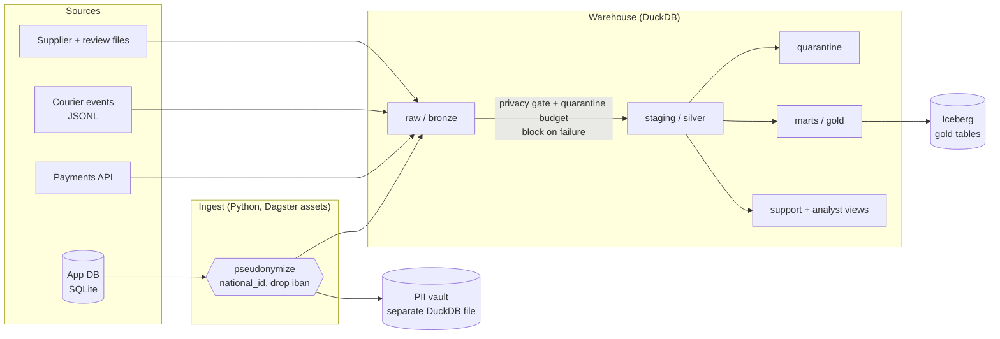

# Qafila Lakehouse

By: Noor Alenezi, @SADAIAAcademy· **Run it:** `uv run python capstone/pipeline.py`

## Problem
Qafila's operations and finance teams look at the same numbers every morning: how much each city sold, and whether couriers kept the 30-minute promise. Today those numbers come from five sources with known problems (duplicate accounts, erased customers, a payments feed that changes shape, phones that resend events), and the customer data includes national IDs that must not spread.

**Our platform takes** the app database, the payment provider's API, courier events and supplier/review files **and produces** a star schema, a daily city sales mart and a per-store delivery operations view (both published to Iceberg), **refreshed** nightly at 01:30 Riyadh time, **trusted because** of 64 dbt tests, a data contract, two blocking gates (privacy and payments quarantine), a volume monitor and an SLA alert.

## Sources
| Source | Type | Volume | Refresh | Load strategy | Known issues |
|---|---|---|---|---|---|
| App DB: orders, order_items, stores, products | Database (SQLite) | 45,766 orders, 172,545 lines | nightly | full snapshot, swapped in one transaction | 142 negative quantities; 1,040 orders of erased customers |
| App DB: customers | Database (SQLite) | 7,442 accounts / 7,384 people | nightly | full snapshot + pseudonymization at ingestion | duplicate accounts (58 people), mixed mobile formats, national IDs and IBANs |
| Payments | API (paged, rate-limited) | 41,785 payments | nightly | **incremental** on `updated_at`, upsert by `payment_id` | 16 non-positive amounts; `wallet_provider` added 15 Sep; 429s |
| Delivery events | Events (JSON lines) | 22,518 events, last 7 days | nightly | **incremental** on `ingest_time`, append | 312 resent events; late events; three timestamp formats |
| Supplier prices | Files (weekly CSV) | 4 files | weekly | full re-read | W38 decimal commas + Arabic digits; W39 renamed column |
| Reviews | File (CSV) | 3,000 | nightly | full re-read | none found |

## Architecture


| Stage | Tool | Why |
|---|---|---|
| Ingest | Python + DuckDB readers, run as Dagster assets | Sources are small and local; we needed full control over cursors and transactions |
| Store | DuckDB file | One file, no server, columnar and fast for this volume |
| Transform + test | dbt (dbt-duckdb) | SQL models with lineage, tests and an enforced contract on the main fact |
| Orchestrate + observe | Dagster | Assets and lineage across Python and dbt; dbt tests become asset checks; blocking checks; schedule |
| Serve | Iceberg (pyiceberg) | Gold tables any engine can read (DuckDB, Polars, Spark) with atomic commits and time travel |
| Govern | HMAC pseudonymization, a PII vault, role views | Plain hashes of IDs are reversible; keyed tokens are not |

Orchestrator note: the job runs **in one process** because DuckDB allows one writer at a time.

## Data model
| Table | Layer | Grain (one row per...) | Keys | Materialization |
|---|---|---|---|---|
| `fct_order_items` | gold | order line with a positive quantity | `order_line_id` (= order_id·100 + line_no) | **incremental** (delete+insert, 3-day look-back), enforced contract |
| `fct_orders` | gold | order | `order_id` | table |
| `dim_customers` | gold | customer account, plus unknown member `-1` | `customer_id` | table |
| `dim_products` | gold | product | `product_id` | table |
| `dim_stores` | gold | store | `store_id` | table |
| `dim_date` | gold | calendar day (2026), Saudi weekend Fri–Sat | `date_day` | table |
| `mart_daily_city_sales` | gold | Riyadh calendar day × city | `order_date`, `city` | table → Iceberg `gold.daily_city_sales` |
| `mart_store_delivery_ops` | gold | Riyadh calendar day × store, for orders in the event stream | `order_date`, `store_id` | table → Iceberg `gold.store_delivery_ops` |
| `qrn_payments`, `qrn_order_items` | quarantine | rejected row, with `reject_reason` | source key | table |
| `support_customers`, `analyst_customers` | serve | customer account | `customer_id` | view |

Decisions worth defending:
- **Revenue excludes delivery fees** in `fct_order_items`; `fct_orders` adds the fee once per order. Joining fees to lines would overstate revenue by 14%.
- **Erased customers' orders stay** in the facts, pointing to `customer_id = -1`: the sale happened, the person is gone.
- **Riyadh calendar days** everywhere a date is shown (`created_at + 3h`); 22:35 UTC on the 27th is the 28th in Riyadh.

## Quality and observability
| Check | Where | Severity | What it caught |
|---|---|---|---|
| Privacy gate: no national ID / IBAN in `raw.customers` | Dagster asset check | **blocking** | 0 (by design); fails if anyone reintroduces the columns |
| Payment quarantine budget ≤ 1% | Dagster asset check | **blocking** | 16 rows (0.04%) → passes, rows go to `qrn_payments` |
| Payments data contract (ODCS) | Dagster asset check | warn | **16 non-positive amounts** |
| `stg_orders.customer_id` → `stg_customers` | dbt relationships | warn | **1,040 orders of PDPL-erased customers** → mapped to `-1` in marts |
| `stg_order_items.quantity` positive | dbt custom generic test | warn → quarantine | **142 negative lines** → `qrn_order_items` |
| Order total = captured payment | dbt singular test | warn | **244 delivered orders** whose captured amount differs from the order total (finance follow-up) |
| Payments quarantined < 1% | dbt singular test | error | — |
| No identifier columns in `marts` / `analyst` | dbt singular test | error | — |
| Events not received before they happen | dbt singular test | error | — (validates the three timestamp parsers) |
| Delivery time between 0 and 180 min | dbt singular test | error | — |
| SLA rates between 0 and 1 | dbt singular test | error | — |
| Unique / not null / accepted values / relationships | dbt generic tests on every model | error | — |
| Supplier cost positive | dbt custom generic test | warn | **4 zero/negative costs** in the week-39 file |
| Unit tests: 3 timestamp formats, resent events, supplier number formats | dbt unit tests | error | — |
| Order volume vs. same weekday's 4-week median | Dagster asset check | warn | nothing in Aug–Sep (lowest day stays above 70%); it guards against a partial load |
| Store SLA alert: latest day under 50% on time | Dagster asset check | warn | **RUH-01 (Olaya)**: 39% on time on 30 Sep (35–42% every day), the busiest store |

At least one real problem found: **1,040 orders belong to customers who were erased under PDPL.** The relationships test finds them on every run; instead of dropping the sales (and understating revenue) the facts map them to an "unknown" customer member, so revenue stays complete and no personal data is resurrected.

## Results (latest run)
`dbt build`: 91 nodes (23 models, 64 tests, 3 unit tests, 1 seed): **87 pass, 4 warn, 0 errors**. Dagster: 35 assets, 66 checks.

| Table | Rows |
|---|---|
| `raw.payments` | 41,785 |
| `raw.delivery_events` | 22,518 (312 resent by phones, dropped in staging) |
| `marts.fct_orders` | 45,766 |
| `marts.fct_order_items` | 172,403 (172,545 lines − 142 negative quantities) |
| `marts.mart_daily_city_sales` | 183 (61 days × 3 cities) |
| `marts.mart_store_delivery_ops` | 84 (7 days × 12 stores) |
| `quarantine.qrn_payments` | 16 |
| `quarantine.qrn_order_items` | 142 |

## Incremental loads and re-runs
| Source | Key | Cursor | Look-back | Atomicity |
|---|---|---|---|---|
| Payments | `payment_id` (upsert: refunds replace the old row) | max `updated_at` loaded | the API's `updated_since` is inclusive, so the boundary row is re-fetched and upserted harmlessly | DELETE + INSERT + cursor move in **one transaction** |
| Delivery events | append; staging dedupes on `event_id` | max `ingest_time` loaded (arrival time, so late events are not missed) | none needed | INSERT + cursor move in one transaction |
| `fct_order_items` | `order_line_id` | max `order_updated_at_utc` | 3 days (late status changes) | dbt delete+insert |

`--as-of` replays only the incremental sources (payments through the mock API's clock, events by arrival time); the app tables are snapshots of the current state either way.

Every batch from the API is also written to `artifacts/capstone/landing/payments/` before loading, as an audit trail. Cursors and a run log live in `ops.ingest_state` and `ops.ingest_log`.

**Evidence (live demo):**
```bash
uv run python capstone/pipeline.py --reset --as-of 2026-09-27   # payments 39,689 | events 13,506
uv run python capstone/pipeline.py --as-of 2026-09-27           # re-run: still 39,689 | 13,506 — nothing duplicated
uv run python capstone/pipeline.py                              # payments: +2,152 fetched (2,096 new, 56 refunds updated) -> 41,785 | events: +9,012 -> 22,518
```

## Governance note
| Column | Classification (NDMO level) | Protection | Who can see it raw |
|---|---|---|---|
| `customers.national_id` | Secret | Replaced at ingestion by `person_token` = HMAC-SHA256(key, id); raw value only in the PII vault | Vault owner only |
| `customers.iban` | Secret | Dropped at ingestion; vault only | Vault owner (payments domain) |
| `customers.full_name` | Restricted | Staging only; not in marts; shown in `support.support_customers` | Support |
| `customers.email` | Restricted | Masked for support (`a***@gmail.com`); analysts get the domain only | Support (masked) |
| `customers.mobile` | Restricted | Normalized to E.164; masked for support (`+9665•••••24`) | Support (masked) |
| `customers.district` | Restricted | Kept: coarse location needed for delivery analytics | Analysts |
| `payments.card_last4` | Restricted | Truncated by the provider; never in marts | Payments team |
| `delivery_events.lat/lon`, `courier_id` | Restricted | Staging only; the ops mart aggregates per store and day | Ops engineers |

- **Why a key, not a hash:** an attacker with a leaked list of IDs can hash it and match a plain SHA-256 column; without the key, an HMAC token matches nothing. The key comes from `QAFILA_PSEUDO_KEY` (secret manager in production; the demo uses a dev key and says so).
- **Access by role:** support reads `support.*`, analysts read `analyst.*` and `marts.*`; neither schema contains a direct identifier, and a dbt test fails the build if one appears.
- **No personal data in git:** all data, the warehouse and the vault live under `artifacts/` and `data/`, both git-ignored.

**Erasure:** a PDPL deletion request for customer *X*: (1) the app deletes the row; (2) the next nightly run swaps `raw.customers` and the vault table, so *X* disappears from both; (3) staging and the serve views follow at once; (4) *X*'s orders remain in the facts under `customer_id = -1` (no personal data in them); (5) old Iceberg snapshots of gold tables contain no customer columns, but we still expire snapshots older than the retention window; (6) payment batches in `landing/` hold no customer identifiers (order IDs and card last-4 only) and are purged after 30 days.

## Reproduce
```bash
git clone https://github.com/noorSalenezi/N-Data-Engineering-project && cd N-Data-Engineering-project
uv sync
uv run python prepare_data.py                    # synthetic data, fixed seed (≈35 MB, seconds)
uv run python capstone/pipeline.py               # one command, end to end
uv run dagster dev -f capstone/pipeline.py       # UI (optional): lineage, checks, schedule
uv run --with pytest pytest capstone/tests -q    # privacy unit tests
```
Data: generated locally by `prepare_data.py` (no download, no real people). Tool versions: pinned in `uv.lock`.

Course repository: [SDAIAAcademy/data-engineering](https://github.com/SDAIAAcademy/data-engineering) (data generator and environment).

## Limitations and next steps
- **At 100× volume:** the app tables would stop being full snapshots (switch to the CDC feed and MERGE); the single DuckDB writer becomes the bottleneck, so raw would move to Iceberg tables and the transforms to a warehouse engine or Spark.
- **Delivery events** are batch micro-loads; a real stream (Kafka + watermarks) would give minute-level SLA alerts.
- **Access control** is by schema convention in a single DuckDB file; a production setup would enforce it with grants in the warehouse or catalog.
- **Two more weeks:** a small dashboard on the gold tables, freshness SLAs per source, and alert routing to the owners named in the payments contract.
